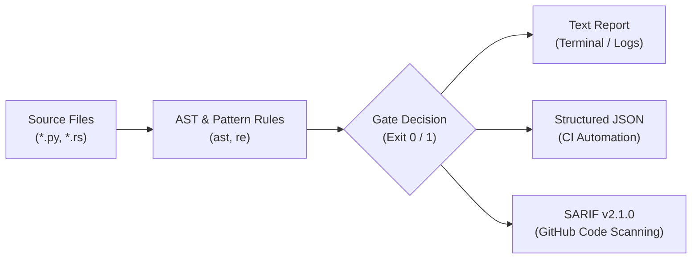

# corral-lite

[](https://github.com/NatthaphongY/corral-lite/actions)
[](https://opensource.org/licenses/Apache-2.0)
[](https://www.python.org/downloads/)
[](https://peps.python.org/pep-0561/)

> **Fast, deterministic AST and pattern static verification engine for Python and Rust with zero external dependencies.**

Corral-Lite provides instant, reproducible static gatekeeper checks designed to eliminate silent error swallowing, unsafe dynamic code execution, mutable default state bugs, and structural defects before code reaches pull requests or production.

> 🤖 **AI Agents**: See [llms.txt](llms.txt) for low-token API/CLI discovery and [AGENTS.md](AGENTS.md) for coding-agent repository invariants.

---

## Architecture Pipeline

Corral-Lite processes source files through a deterministic pipeline that maps directly to fail-closed gate decisions and standardized compliance artifacts:



---

## Key Capabilities

- **Zero Heavy Runtime Dependencies**: Pure Python standard library implementation (`ast`, `re`, `json`, `argparse`). Instant installation with zero supply-chain risk.
- **Strictly Deterministic**: Reproducible pass/fail verdicts with identical exit codes across Windows, Linux, and macOS.
- **Fail-Closed Gatekeeper**: Blocking violations immediately yield exit code `1`, preventing flawed pull requests from merging. Advisory findings provide actionable feedback without breaking pipelines.
- **SARIF v2.1.0 Native**: Direct support for OASIS SARIF v2.1.0 exports, seamlessly integrating with GitHub Advanced Security and Code Scanning alerts.
- **Typed & Standards-Compliant**: Fully typed PEP 561 package (`src/` layout, `py.typed`) ready for strict static typing setups.
- **Normative Specification Alignment**: Implements core verification checks aligned with the [CORRAL Verification Specification (CVS) v1.0](docs/spec/CORRAL_VERIFICATION_SPECIFICATION_v1.md).

---

## 30-Second Quickstart

### Installation

Install directly from GitHub via `pip`:

```bash
pip install git+https://github.com/NatthaphongY/corral-lite.git
```

Or clone the repository and install in editable mode:

```bash
git clone https://github.com/NatthaphongY/corral-lite.git
cd corral-lite
pip install -e .
```

### Basic Scan

Run static verification against any target file or directory tree:

```bash
corral-lite check src/
# or invoke as a Python module:
python -m corral_lite.cli check src/
```

If any **blocking** finding is detected, `corral-lite` exits with code `1`. If only advisory findings or zero findings are detected, it exits with code `0`.

---

## Verification Rules

Corral-Lite inspects codebases against 10 deterministic static verification rules:

| Rule ID | Language | Severity | Title | Description |
|---|---|---|---|---|
| **PY001** | Python | Blocking | Bare / Broad Except Pass | Flags `except:` or `except Exception:` blocks containing only `pass`. |
| **PY002** | Python | Blocking | Mutable Default Argument | Flags function definitions with mutable collections (`[]`, `{}`, `set()`) as defaults. |
| **PY003** | Python | Blocking | Eval / Exec Invocations | Flags direct invocations of dynamic execution builtins `eval()` or `exec()`. |
| **PY004** | Python | Advisory | Wildcard Import | Flags wildcard imports of the form `from module import *`. |
| **PY005** | Python | Advisory | Unguarded `json.loads` | Flags `json.loads()` calls executed outside an enclosing `try-except` block. |
| **PY006** | Python | Blocking | Subprocess `shell=True` | Flags `subprocess` executions using `shell=True`. |
| **PY007** | Python | Blocking | Assert in Non-Test Code | Flags `assert` statements used in non-test production modules. |
| **PY008** | Python | Blocking | Hardcoded Secret Literal | Flags credential variables assigned static secret string literals. |
| **RS001** | Rust | Blocking | Unguarded Unwrap / Panic | Flags `.unwrap()`, `.expect()`, or `panic!()` in non-test Rust code. |
| **RS002** | Rust | Blocking | Identical Conditional Branches | Flags duplicate logic executed across both `if` and `else` branches. |

---

## Output Formats

### 1. Human-Readable Terminal (Default)

```text
======================================================================
CORRAL-LITE VERIFICATION REPORT
======================================================================
Verdict: FAILED
Total Findings: 1 (Blocking: 1, Advisory: 0)

[BLOCKING] PY001: src/worker.py:42:4
  Message: Broad or bare except block silenced with pass statement.
  Fix Hint: Handle the exception, log with diagnostic context, or propagate upward.
======================================================================
```

### 2. Machine-Readable JSON

Export structured findings for automated tooling:

```bash
corral-lite check src/ --format json
```

```json
{
  "verdict": "FAILED",
  "findings_count": 1,
  "blocking_count": 1,
  "findings": [
    {
      "rule_id": "PY001",
      "severity": "blocking",
      "file_path": "src/worker.py",
      "line": 42,
      "column": 4,
      "message": "Broad or bare except block silenced with pass statement.",
      "fix_hint": "Handle the exception, log with diagnostic context, or propagate upward."
    }
  ]
}
```

### 3. OASIS SARIF v2.1.0 for GitHub Code Scanning

Export findings directly to SARIF and integrate with GitHub Actions:

```bash
corral-lite check src/ --format sarif > results.sarif
```

In your `.github/workflows/ci.yml`:
```yaml
- name: Run Corral-Lite Gate
  run: corral-lite check src/ --format sarif > results.sarif
  continue-on-error: true

- name: Upload SARIF report
  uses: github/codeql-action/upload-sarif@v3
  with:
    sarif_file: results.sarif
```

---

## Python API

Integrate Corral-Lite directly into your Python scripts or test harnesses:

```python
from corral_lite import verify_path, Severity

findings = verify_path("src/")
for finding in findings:
    if finding.severity == Severity.BLOCKING:
        print(f"Blocking violation: {finding.rule_id} at {finding.file_path}:{finding.line}")
```

---

## Contributing

We welcome contributions! Please see [CONTRIBUTING.md](CONTRIBUTING.md) for local development setup, test instructions, and contribution guidelines.

---

## Security

Please review our [SECURITY.md](SECURITY.md) for vulnerability disclosure procedures.

---

## License

This project is licensed under the Apache License, Version 2.0. See [LICENSE](LICENSE) for details.
